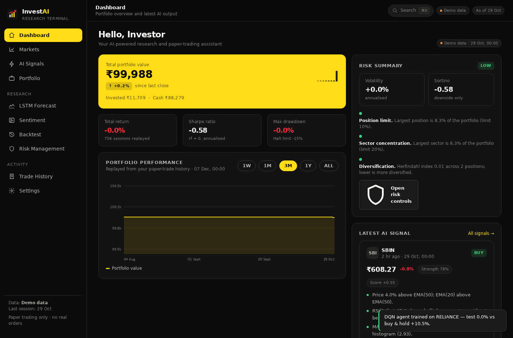
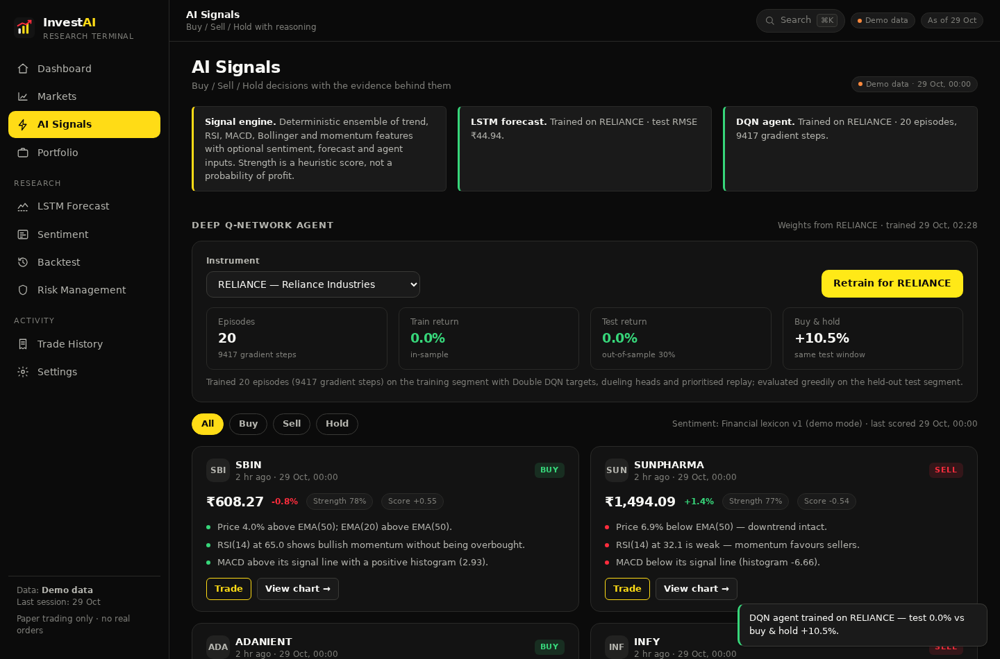
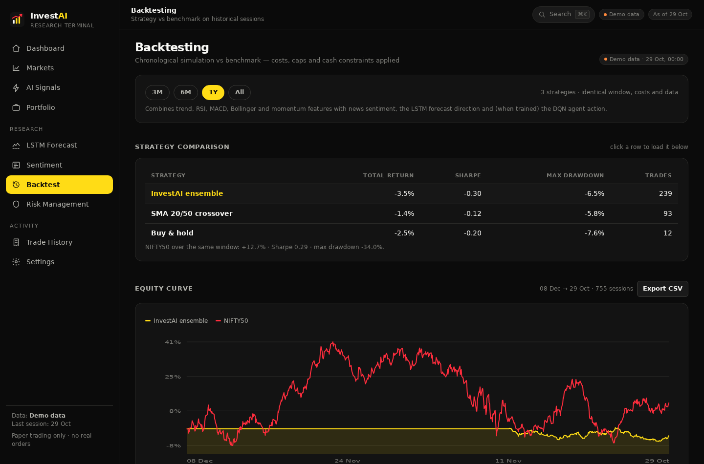
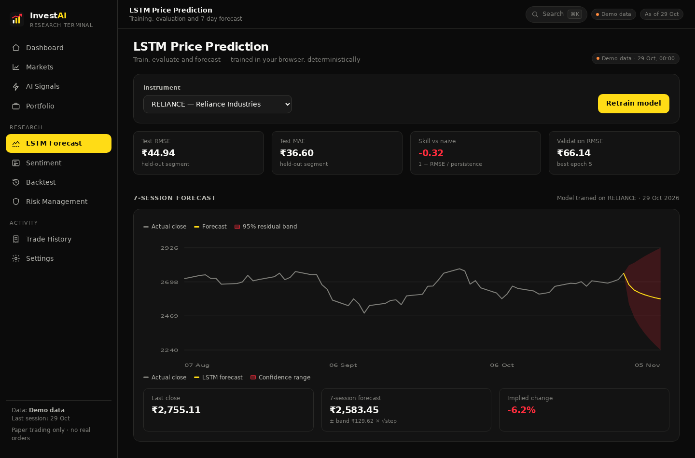
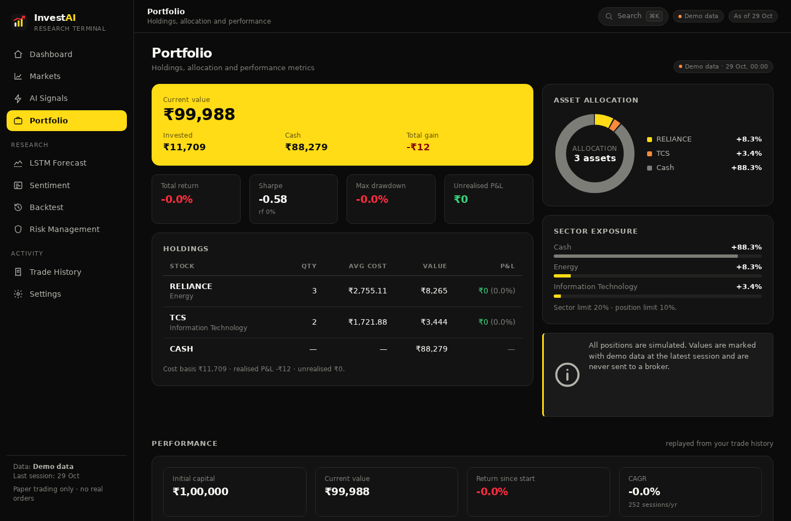
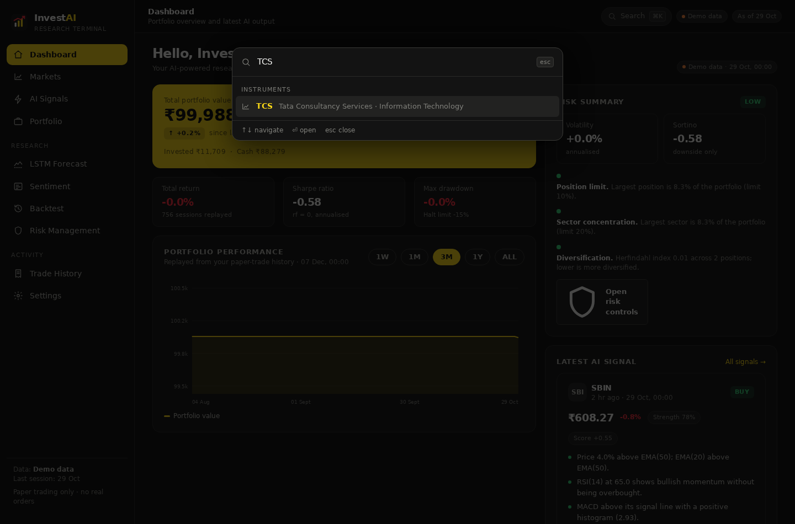
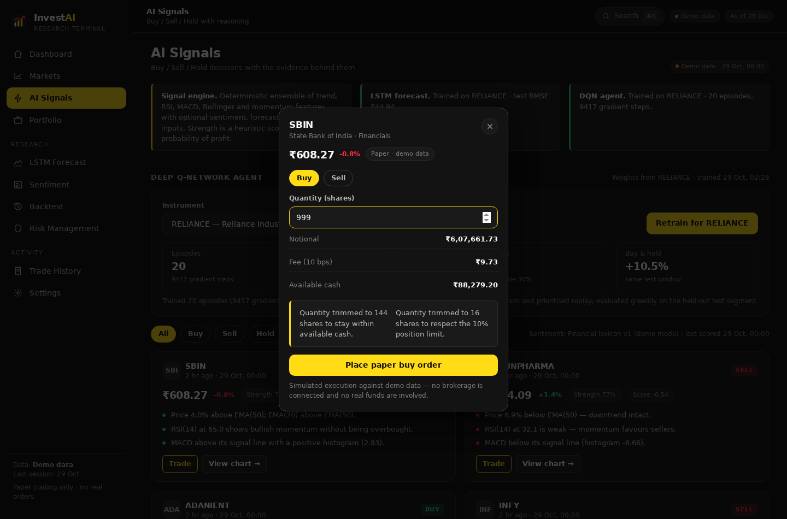
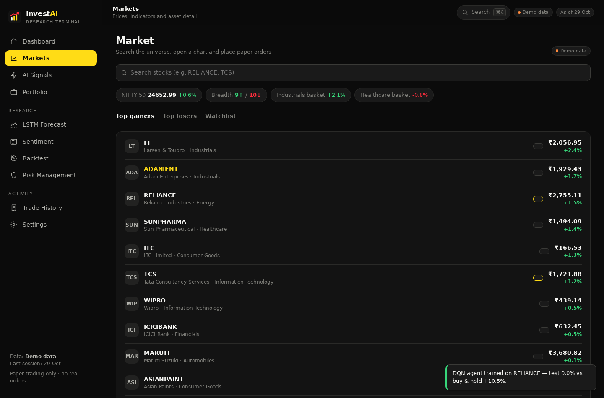
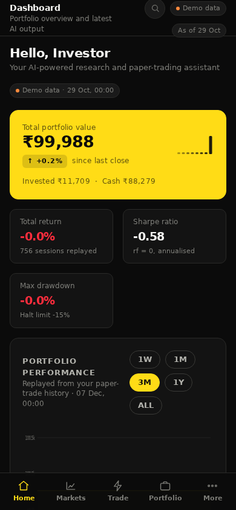

<div align="center">

# InvestAI

### An autonomous investment & risk-management research terminal that runs entirely in your browser

**LSTM forecasting · FinBERT-ready sentiment · Deep Q-Network trading agent · layered risk controls · chronological backtesting — with zero backend, zero API keys and zero real money.**

[](https://github.com/AMOGHKADADI/Invest-ai/actions/workflows/ci.yml)
[](#-testing)
[](tsconfig.json)
[](https://react.dev/)
[](LICENSE)
[](#data-sources--limitations)

**[▶ Live demo](https://amoghkadadi.github.io/Invest-ai/)** · **[Quick start](#-quick-start)** · **[Why you can trust it](#-how-it-keeps-you-honest)** · **[Architecture](#-architecture)**

</div>

---



## What is this?

InvestAI is a **complete, self-contained implementation** of the system proposed in our Visvesvaraya Technological University Phase 1 project *"AI-driven autonomous Investment and Risk Management using Reinforcement Learning"* — rebuilt as a production-quality web application that anyone can run with two commands.

Most "AI trading" demos are either slideware or black boxes you must trust. This one is different:

| | |
|---|---|
| 🧠 **Real models, not mocks** | An LSTM trains in your browser with train/validation/test splits and held-out metrics. A dueling Double-DQN with prioritised replay learns Buy/Sell/Hold in a cost-aware environment. Both are gradient-checked by the test suite. |
| 🚫 **No look-ahead, by construction** | Signals read only the past, backtests fill at the *next* open, sentiment is time-sliced, and models trained on the full series are deliberately excluded from backtests. Every rule is enforced in code and covered by tests. |
| 🧭 **Built for speed of use** | ⌘K command palette to jump anywhere, a trade ticket reachable from every signal card, live risk previews *before* you submit, toast feedback for every action, and one-click CSV exports of trades and backtest curves. |
| 🔒 **Nothing to configure** | No server, no database, no API keys, no brokerage. Deterministic demo data plus CSV import. Clone → `npm install` → it works, offline. |
| 🎯 **Honest by design** | Every figure carries its provenance tag (demo / imported / model). Disabled features *say* they're disabled. No "guaranteed returns" language anywhere. |

**Everything below is real, working software** — not a prototype: paper-trading with fees and risk limits, a searchable market screen with technical indicators, a backtest engine vs. an index benchmark, sentiment classification with a clean lexicon→FinBERT boundary, and an MIT-licensed codebase with 109 unit tests.

---

## 📸 Screenshots

<table>
<tr>
<td width="50%"><sub><b>AI signals with factor attribution</b></sub><br></td>
<td width="50%"><sub><b>Backtest vs. index benchmark</b></sub><br></td>
</tr>
<tr>
<td><sub><b>LSTM training & 7-session forecast</b></sub><br></td>
<td><sub><b>Portfolio & allocation</b></sub><br></td>
</tr>
<tr>
<td><sub><b>⌘K command palette</b></sub><br></td>
<td><sub><b>Trade ticket with live risk preview</b></sub><br></td>
</tr>
<tr>
<td><sub><b>Markets with indicators</b></sub><br></td>
<td><sub><b>Mobile layout</b></sub><br></td>
</tr>
</table>

---

## ⚡ Quick start

```bash
git clone https://github.com/AMOGHKADADI/Invest-ai.git
cd Invest-ai
npm ci
npm run dev        # → http://localhost:5173
```

That's it. No environment variables, no sign-up, no API keys.

| Command | What it does |
|---|---|
| `npm run dev` | Dev server with hot reload |
| `npm run test` | 109 unit tests (financial math, models, no-look-ahead) |
| `npm run lint` · `npm run typecheck` | ESLint + strict TypeScript |
| `npm run build` | Typecheck + production bundle (~100 kB gzipped) |
| `npm run ci` | Everything CI runs |

---

## 🧭 What's inside

**Dashboard** — portfolio value, day change, drawdown, risk summary, latest signal, replayed equity curve, all timestamped and source-tagged.

**⌘K command palette** — one shortcut to search instruments, jump to any screen or trigger key actions (train a model, export trades), keyboard-first with no chrome.

**Markets** — an 18-instrument universe with market pulse (index, breadth, strongest sector baskets), searchable list, per-asset detail with price chart and SMA/EMA, RSI, MACD, Bollinger, ATR and volatility readouts; watchlist; one-click paper orders.

**AI signals** — Buy/Sell/Hold from a deterministic ensemble of trend, momentum and volatility features, *plus* sentiment, LSTM forecast direction and the DQN action when those models exist — each factor shown with its evidence and score.

**LSTM forecasting** — full training pipeline in the browser: seeded weights, 60/20/20 split, early stopping, held-out RMSE/MAE, skill vs. a persistence baseline, training curves, and a 7-session forecast with a widening residual band.

**Deep Q-Network agent** — dueling architecture, prioritised experience replay, Double-DQN targets, transaction costs inside the reward, 70/30 train/test with a buy-and-hold comparison reported honestly.

**Sentiment** — a transparent financial lexicon in the browser today, and a FinBERT HTTP adapter that activates only when you point it at a hosted endpoint (it fails closed — it will never silently pretend to be a transformer).

**Trade ticket from anywhere** — every signal card opens a modal order ticket that runs the risk layer *as you type*: trims and blocks appear before you submit, and the outcome lands as a toast.

**Risk management** — stop-loss, single-position cap, sector diversification cap and drawdown halt. Every order passes `evaluateOrder`: quantities are trimmed or blocked with a human-readable reason, and you can watch it happen.

**Portfolio** — holdings, asset/sector allocation donuts, P&L, and equity + drawdown charts replayed from your own trade history.

**Backtesting** — chronological engine: signals from session *t* fill at *t+1*'s open, costs on every fill, cash and position constraints, benchmark comparison. All three strategies run over the identical window side by side — click a row to load it — and any curve exports to CSV.

**Trade history & settings** — every simulated fill with fees and rationale, exportable to CSV; capital, cost and model switches; CSV import; portfolio reset; toast feedback for every action.

---

## 🔬 How it keeps you honest

Quantitative projects die the moment the numbers can't be trusted. These invariants are enforced in code and locked in by tests:

1. **Causal signals** — indicator/signal evaluation at session *t* reads only bars up to *t − 1*.
2. **No same-bar fills** — the backtester decides on yesterday's information and executes at today's open; running it on a truncated series yields identical trades for that window.
3. **Time-sliced news** — sentiment aggregation at timestamp *T* ignores every headline published after *T*.
4. **Clean splits** — LSTM normalisation statistics come from the training segment only; test segments are held out and reported separately.
5. **No leakage from trained weights** — because the LSTM/DQN train on the full series, they are *excluded* from backtest inputs. The UI explains why.
6. **Provenance everywhere** — demo, imported and model-derived figures are labelled distinctly, on every screen.
7. **No silent fallbacks** — the FinBERT adapter errors visibly when unconfigured; a disabled feature reports itself as disabled.

---

## 🏗️ Architecture

```
src/
├── lib/                    # Framework-free domain core — every unit test lives here
│   ├── indicators.ts       # SMA · EMA · RSI · MACD · Bollinger · ATR · volatility
│   ├── signals.ts          # Causal feature computation + signal engine
│   ├── lstm.ts             # LSTM forward/backward, Adam, early stopping, forecasting
│   ├── dqn.ts              # Dueling Double-DQN, prioritised replay, trading env
│   ├── sentiment.ts        # Lexicon analyzer + FinBERT HTTP adapter (fails closed)
│   ├── risk.ts             # evaluateOrder: caps · stop-loss · drawdown halt
│   ├── portfolio.ts        # Fees, fills, valuation, allocation, equity replay
│   ├── metrics.ts          # Sharpe · Sortino · drawdown · CAGR · Calmar
│   ├── backtest.ts         # Chronological engine + benchmark
│   ├── strategies.ts       # InvestAI ensemble · SMA crossover · buy & hold
│   ├── csv.ts · download.ts · demoData.ts · format.ts · optim.ts · types.ts
├── app/                    # store (state + training), overlay (toasts + order ticket), nav
├── components/             # App shell, ⌘K palette, order ticket, SVG charts, UI primitives
├── pages/                  # 12 routed screens
└── styles/                 # Design tokens + responsive CSS
```

**Stack:** TypeScript (strict) · React 18 · Vite 6 · React Router · Vitest · ESLint 9.
**Runtime dependencies: 3** (react, react-dom, react-router-dom). Charts are hand-drawn SVG; models are implemented in-repo — no chart or ML runtime shipped.

```
demo data / CSV ──► causal features ──► signal engine ◄── sentiment / LSTM / DQN
                                              │
                                              ▼
                                     risk layer (evaluateOrder)
                                              │
                                              ▼
                              paper fills ──► portfolio ──► metrics ──► dashboard
```

---

## 🧪 Testing

```bash
npm run test     # 109 tests, ~3s
```

- **Financial math** — indicator known-values, Sharpe/Sortino/drawdown on hand-computed fixtures, fee and P&L accounting, allocation.
- **Model integrity** — *finite-difference gradient checks* against the analytical backward passes of both the LSTM and the DQN network; seed reproducibility.
- **Backtest correctness** — cost application, chronological execution, and a dedicated no-look-ahead regression test.
- **Risk rules** — trimming, blocking, stop-loss and drawdown-halt behaviour.
- **Inputs** — CSV parsing edge cases, CSV serialisation/escaping, sentiment classification boundaries.

CI runs lint → typecheck → test → build on every push and pull request.

---

## 🎓 Academic context

This repository accompanies the VTU B.E. Phase 1 project *"AI-driven autonomous Investment and Risk Management using Reinforcement Learning"* (Dept. of CSE, Brindavan College of Engineering, 2025–26), which proposes a self-learning agent combining a DQN decision engine with LSTM forecasting, NLP sentiment, a risk-constraint layer, portfolio optimization and a monitoring dashboard.

The report's proposed Python/TensorFlow/PostgreSQL stack is intentionally **not** replicated here: a static site cannot hold API keys or serve a training backend. Instead, this codebase implements the same architecture faithfully and *verifiably* in the browser, and separates what exists today from what remains Phase 2 scope:

| Report component | Status here |
|---|---|
| Data pipeline & feature engineering | ✅ implemented (causal, tested) |
| DQN agent (dueling, PER, Double-DQN) | ✅ implemented — trains in-browser |
| LSTM forecasting module | ✅ implemented — full eval protocol |
| Sentiment analysis | ✅ lexicon now · FinBERT adapter behind `VITE_SENTIMENT_API_URL` |
| Risk constraint layer | ✅ implemented — trims or blocks with reasons |
| Portfolio accounting & metrics | ✅ implemented |
| Backtesting vs. benchmark | ✅ implemented — no look-ahead by design |
| Dashboard & reporting | ✅ implemented (this app) |
| Live market/news APIs, PostgreSQL, Dash backend | ⏳ Phase 2 — needs a real server |
| Mean-variance portfolio optimizer | ⏳ Phase 2 |
| Live trading, accounts, notifications | ⏳ Phase 2 — intentionally out of scope |
| Android APK | ❌ not built; none is claimed |

No experimental results, accuracies or benchmarks are claimed beyond what the application computes live in front of you.

---

## 📊 CI/CD & deployment

| Workflow | Trigger | Does |
|---|---|---|
| [CI](.github/workflows/ci.yml) | push + PR to `main` | `npm ci` → lint → typecheck → 107 tests → production build |
| [Deploy](.github/workflows/deploy.yml) | push to `main` | test → build → publish `dist/` to **GitHub Pages** |

Least-privilege permissions throughout (`contents: read`; the deploy job adds `pages: write` + `id-token: write` for OIDC). The Pages build sets `VITE_BASE_PATH=/Invest-ai/` so assets resolve under the project path; local dev stays at `/`.

**Publishing:** Settings → Pages → Source: **GitHub Actions**, then re-run the Deploy workflow.

---

## 🔐 Security

- No secrets, tokens or credentials exist anywhere in the codebase or bundle.
- `.env*` is git-ignored; the app makes no network calls unless you configure a sentiment endpoint yourself.
- All state (settings, paper trades, trained weights) stays in your browser's `localStorage` — nothing is transmitted.
- The app never connects to a brokerage and cannot move money.

---

## 📈 Data sources & limitations

- **Demo data** is deterministic, synthetic and labelled *Demo* on every screen — it is not market data.
- **CSV import** (`date,open,high,low,close,volume`[,symbol]) swaps the dataset until you restore the demo.
- Live prices/news (Yahoo Finance, Alpha Vantage, NewsAPI per the report) require a server with credentials — Phase 2.
- Browser-side training caps dataset size and model capacity; these models demonstrate the architecture, not predictive power.
- Backtests ignore slippage beyond the flat fee, liquidity, dividends and survivorship effects.

---

## 🗺️ Roadmap

- [ ] Hosted Python backend (TensorFlow/Keras DQN + LSTM, FinBERT via Hugging Face)
- [ ] Live market-data and news ingestion behind server-side credentials
- [ ] Mean-variance portfolio optimization and rebalancing
- [ ] Walk-forward cross-validation for the backtester
- [ ] Android client (Kotlin/Compose) — no APK exists today

Contributions welcome — open an issue first so we can align on design.

---

## 📄 License

[MIT](LICENSE) — use it, learn from it, build on it.

<div align="subtle">
<sub>Built for research and education. Nothing here is investment advice, and no part of this project can place a real trade.</sub>
</div>
